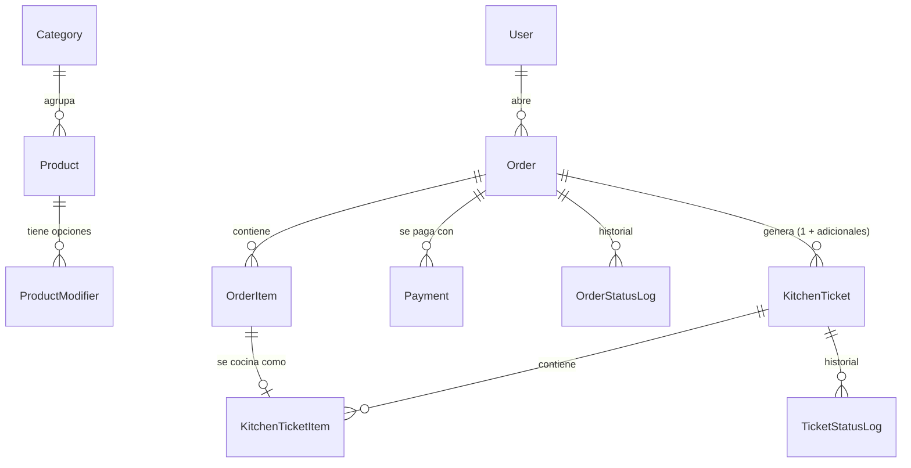

# Delycia POS

Punto de venta web para **Delycia** (restaurante casual boliviano, Santa Cruz de la Sierra).
Fase 1: **Ventas + Cocina (KDS)** en tiempo real, con la arquitectura preparada para sumar
reportería, inventario, costos/recetas, clientes y roles sin reescribir lo existente.

> Estado: **cobro, historial y cierre de caja listos**. Anulaciones: pendiente. Ver [Hoja de ruta](#hoja-de-ruta).

---

## Stack y por qué

| Capa | Elección | Por qué |
|---|---|---|
| App | Next.js 16 (App Router) + TypeScript | Front y back en un solo despliegue: ideal para un monolito de un local. |
| Base de datos | PostgreSQL 16 + Prisma 7 | Transacciones reales (enviar a cocina o cobrar nunca queda a medias) y migraciones versionadas. |
| UI | Tailwind CSS 4 + componentes estilo shadcn/ui | Componentes accesibles, fáciles de agrandar para pantallas táctiles. |
| Validación | Zod | Un mismo esquema valida formularios y servicios. |
| Tiempo real | Server-Sent Events (SSE) | El servidor solo necesita *empujar* a las pantallas; el navegador reconecta solo. |
| Tests | Vitest | Rápido y compatible con TypeScript sin configuración extra. |
| Infra local | Docker + docker-compose | Un comando levanta base de datos, migraciones y app. |

**Dinero:** siempre enteros en centavos (`src/core/money`). Nunca `float`.

## Arquitectura: monolito modular

```
src/
├─ app/            # Rutas (Next.js). Solo composición: sin lógica de negocio.
├─ config/         # Raíz de composición: qué módulos están activos.
├─ core/           # Núcleo compartido: dinero, eventos, registro de módulos, config.
├─ modules/
│  ├─ catalog/     # Categorías, productos, modificadores
│  ├─ sales/       # Órdenes, carrito, cobro, anulaciones
│  └─ kitchen/     # Comandas y pantalla de cocina (KDS)
├─ components/     # UI compartida (ui/ = componentes base, shell/ = menú y layout)
└─ lib/
```

Reglas (las vigila ESLint, no solo la disciplina):

1. **Un módulo solo se importa por su API pública**: `@/modules/sales`, nunca `@/modules/sales/services/...`.
2. **`core` no depende de ningún módulo.**
3. **Los módulos se hablan por eventos de dominio.** Ventas emite `order.sent_to_kitchen`;
   Cocina lo escucha y crea la comanda. Cocina emite `ticket.ready`; Ventas avisa al cajero.

```
          order.sent_to_kitchen / order.item_voided / order.cancelled
  Ventas ─────────────────────────────────────────────────────────▶ Cocina
         ◀─────────────────────────────────────────────────────────
                         ticket.ready / ticket.status_changed
```

**Bus de eventos en dos fases** (`src/core/events/bus.ts`):

- `transaction`: el handler corre dentro de la misma transacción de base de datos. Si algo falla,
  se revierte todo. Así nunca queda "ítem enviado a cocina" sin su comanda.
- `afterCommit`: corre después de confirmar. Lo usa el empuje por SSE a las pantallas.

Cada evento queda guardado en una tabla (`DomainEvent`), útil para auditoría y reportes.

### Tiempo real (caja ↔ cocina)

```
 Caja: "Enviar a cocina"
   └─ transacción: marca ítems enviados + Cocina crea la comanda  (todo o nada)
        └─ tras confirmar: evento por SSE ──▶ pantallas conectadas
                                               └─ "algo cambió" → piden el estado completo
```

- **SSE** (`/api/realtime`): el servidor empuja eventos; el navegador reconecta solo.
- **Las pantallas no dependen de recibir cada evento**: al conectarse o reconectarse piden el
  estado completo (`/api/cocina/comandas`). Una tablet que estuvo sin WiFi no pierde comandas.
- **Latido cada 15 s** + vigilante en el cliente: si el WiFi se cae "en silencio" (sin cerrar la
  conexión), a los ~35 s aparece el aviso rojo y se reconecta.
- Probado: comanda en cocina en < 1 s; corte silencioso y corte total con recuperación de las
  comandas enviadas mientras tanto.

**Registro de módulos** (`src/config/modules.ts`): cada módulo declara su nombre, su menú y sus
suscriptores. Si pones `enabled: false`, desaparece del menú, sus rutas devuelven 404 y sus
eventos dejan de escucharse.

## Modelo de datos



| Decisión | Por qué |
|---|---|
| Montos en centavos (`Int`) | Sin errores de redondeo de `float`. |
| `OrderItem` guarda **copia** del nombre, precio y modificadores | Si mañana cambia el precio de un plato, las ventas pasadas no cambian. |
| `OrderItem.sentToKitchenAt` | `null` = todavía no se envió. "Enviar a cocina" manda solo esos. |
| `OrderItem.serviceType` por ítem | Una mesa puede pedir un plato **para llevar**; sale marcado en la comanda. |
| Canal `LOCAL` / `PEYA` + `channelMarkupPercent` | En PEYA todo sube un % global (ej. 40 %). La orden guarda el % que se usó. |
| Método de pago `PEYA` | Separado de `EFECTIVO`, `QR` y `TARJETA` para cuadrar lo que liquida PedidosYa. |
| Método `CUENTA POR COBRAR` | Para fiado: queda registrada la deuda y se cobra después. |
| Nada se borra | Anular = cambiar estado + motivo + hora. Pagos anulados quedan como devueltos. |
| `*StatusLog` y horas por estado | Reportes de tiempos de preparación y "deshacer" en cocina. |
| `DomainEvent` (outbox) | Reconexión del KDS sin perder comandas. |
| `businessDate` en la orden | Numeración y reportes por día de Santa Cruz (America/La_Paz), no por día UTC. |

### Estados

```
Orden:    POR PAGAR ──cobrar──▶ PAGADA ──comandas entregadas──▶ CERRADA (automático)
             └──────────── anular (con motivo) ────────────▶ ANULADA
          "Por pagar" no frena a cocina: se puede enviar a cocina antes de cobrar.
          Una orden PAGADA no se modifica: solo se puede anular.

Comanda:  PENDIENTE ─▶ EN PREPARACIÓN ─▶ LISTA ─▶ ENTREGADA     (+ ANULADA)
          Cada paso se puede deshacer al anterior.
```

### Pantalla de venta

- Productos en botones grandes por categoría, con buscador (ignora tildes).
- Canal **Local / PEYA** (PEYA muestra ya los precios con recargo y es para llevar).
- **Comer aquí / Para llevar** por orden y por ítem: un plato para llevar en una mesa sale marcado
  `PARA LLEVAR`.
- **Mesa** y **nombre del cliente** en cualquier orden. Para comer aquí se pide al menos uno de los dos.
- Tocar una línea abre su editor: cantidad, modificadores, nota para cocina y para llevar.
- **Por pagar** lista las órdenes abiertas; tocar una permite agregarle ítems (se cobran con el mismo
  % PEYA con que se abrió).

### Pantalla de cocina (`/cocina`)

- Modo oscuro, letra grande, tarjetas de la más antigua a la más nueva.
- Temporizador con colores (verde / amarillo / rojo; los minutos se cambian en **Ajustes**).
- Un toque: **Empezar → Marcar lista**. "Lista" ya cuenta como entregada: sale de *En curso* y
  pasa a *Recientes*. Botón ↶ para deshacer (vuelve a *En curso*).
- Tocar un ítem lo marca listo; con todos listos, la comanda pasa sola a "lista".
- Notas resaltadas en amarillo, modificadores en ámbar, **PARA LLEVAR** en naranja.
- Comandas adicionales de la misma orden: **"Mesa 4, adicional"**.
- Pestaña **Recientes** (últimas 3 h) para deshacer un "lista" por error.
- Alarma aguda de ~6 s al llegar una comanda (tocar "Activar sonido" una vez: los navegadores lo exigen).
- Imprimir comanda en 80 mm (impresión del navegador: márgenes "Ninguno").
- Cuando cocina marca una comanda lista, a caja le aparece **"¡Pedido listo!"** con sonido.

### Cobro

- **Cobrar** desde la orden (si hay cambios sin guardar, se guardan primero).
- **Descuento** opcional en Bs o en % (nunca deja la cuenta en negativo).
- Una orden **PEYA** se cobra solo con **PEYA**; en órdenes del local, PEYA no aparece.
- Métodos: **EFECTIVO** (con vuelto y botones rápidos: exacto, 50, 100, 200), **QR**, **TARJETA**,
  **PEYA** y **CUENTA POR COBRAR**. Se pueden combinar (pago mixto). QR, tarjeta, PEYA y fiado no dan
  vuelto: el vuelto sale solo del efectivo.
- Al cobrar: vuelto en grande, **ticket 80 mm** y, si la orden para llevar se cobró antes de enviarla,
  botón **Enviar a cocina**. En **Por pagar** también aparecen las *pagadas esperando cocina*.
- La orden se **cierra sola** cuando está pagada y cocina entregó todo (si cocina deshace la entrega,
  vuelve a "pagada").

### Cuentas por cobrar (fiado)

- Cobrar con **CUENTA POR COBRAR** exige el **nombre del cliente**.
- Reporte **Cuentas por cobrar**: total adeudado, deudores agrupados por nombre (sin importar
  mayúsculas), cuánto debe cada uno y desde hace cuántos días.
- **Registrar pago**: total o abonos parciales, en efectivo, QR o tarjeta. Al completar, la cuenta
  pasa a "saldadas" (se ven las de los últimos 30 días).

### Historial y cierre de caja

- **Historial**: órdenes de cualquier día con filtros por estado, tipo, canal y método de pago; detalle
  con productos, pagos (recibido/vuelto, fiado pendiente) y tiempos de cocina (espera y preparación).
- **Cierre de caja**: ventas brutas, descuentos, netas, ticket promedio, por canal y por medio de pago,
  cobros de fiados del día y productos vendidos. Avisa si quedaron órdenes por pagar.
- **Arqueo**: efectivo (fondo inicial + lo que entró = esperado, contra lo contado), **QR** (contra la
  app del banco) y **tarjeta** (contra el datáfono). Muestra si **cuadra, falta o sobra** en cada uno.
  PEYA y cuentas por cobrar no se cuentan. Se guarda (y se puede corregir) y se imprime en 80 mm.
- Órdenes por pagar de días anteriores se marcan con su fecha (el número se reinicia cada día).

### Menú

El menú inicial está en [`prisma/data/menu-delycia.json`](prisma/data/menu-delycia.json): 34 platos y
extras + 21 bebidas (las bebidas no van a cocina). Se carga **una sola vez** en la primera puesta en
marcha; después se administra desde **Catálogo** y reiniciar no pisa los cambios.

### Usuarios de ejemplo (seed)

| Usuario | PIN | Perfil |
|---|---|---|
| Admin | 1234 | Todo |
| Caja | 1111 | Ventas y cobro |
| Cocina | 2222 | Pantalla de cocina |

> Son PIN de desarrollo: cámbialos antes de usar el sistema en el local.

### Qué puede hacer cada perfil

| Sección | Admin | Caja | Cocina |
|---|:-:|:-:|:-:|
| Vender, cobrar, cuentas por cobrar, historial, cierre de caja | ✅ | ✅ | — |
| Pantalla de cocina | ✅ | ✅ (ver) | ✅ |
| Catálogo (precios, productos) | ✅ | — | — |
| Ajustes (% PEYA, tiempos de cocina) | ✅ | — | — |

Los permisos están en un solo lugar (`src/core/auth/permissions.ts`): de ahí salen tanto el menú
como el bloqueo de rutas (`src/proxy.ts`) y de acciones del servidor. Para crear perfiles nuevos
en el futuro, ese mapa pasa a la base de datos sin tocar el resto.

### PEYA

En **Ajustes** se define el recargo para PedidosYa (ej. 40 %). Se aplica a todos los productos y
el precio se **redondea al boliviano entero**: 38 Bs → 53 Bs; 10 Bs → 14 Bs. La pantalla muestra
una vista previa con productos reales antes de guardar.

---

## Correr en local con Docker (recomendado)

Requisitos: [Docker Desktop](https://www.docker.com/products/docker-desktop/).

```powershell
git clone https://github.com/<tu-usuario>/delycia-pos.git
cd delycia-pos
docker compose up --build
```

Esto levanta:

| Servicio | Qué hace |
|---|---|
| `db` | PostgreSQL 16 (puerto 5432). Crea también la base `delycia_test` para tests. |
| `migrate` | Corre una vez: aplica migraciones y carga los datos de ejemplo. |
| `app` | La aplicación en **http://localhost:3000** |

Los servicios tienen `restart: unless-stopped`: si se reinicia la PC (con Docker Desktop configurado
para iniciar con Windows), la base de datos y la app vuelven a levantar solas.

Para apagar: `docker compose down` (los datos se conservan en el volumen `pgdata`).
Para borrar también los datos: `docker compose down -v`.

## Correr en modo desarrollo (con recarga en caliente)

Requisitos: Node.js 22 y Docker (solo para la base de datos).

```powershell
Copy-Item .env.example .env      # en Linux/macOS: cp .env.example .env
npm install
docker compose up -d db          # solo la base de datos
npm run db:migrate               # aplica migraciones
npm run db:seed                  # datos de ejemplo
npm run dev                      # http://localhost:3000
```

## Abrir la pantalla de cocina desde otro dispositivo (tablet/TV)

La tablet de cocina y la PC que corre el POS deben estar en **la misma red WiFi**.

1. Averigua la IP local de la PC:
   - Windows: `ipconfig` → "Dirección IPv4" (ej. `192.168.1.50`)
   - Linux/macOS: `ip addr` o `ifconfig`
2. En la tablet abre: `http://192.168.1.50:3000/cocina`
3. Si no carga, en Windows permite el puerto 3000 en el firewall (PowerShell como administrador):
   ```powershell
   New-NetFirewallRule -DisplayName "Delycia POS" -Direction Inbound -Protocol TCP -LocalPort 3000 -Action Allow
   ```
4. Consejo: fija la IP de la PC en el router (reserva DHCP) para que la dirección no cambie.

## Comandos útiles

| Comando | Qué hace |
|---|---|
| `npm run dev` | Servidor de desarrollo |
| `npm test` | Tests (Vitest). Los de integración usan la base `delycia_test` (`TEST_DATABASE_URL`) |
| `npm run lint` | ESLint (incluye las reglas de fronteras entre módulos) |
| `npm run typecheck` | Verificación de tipos |
| `npm run db:migrate` | Crea/aplica migraciones en desarrollo |
| `npm run db:seed` | Carga datos de ejemplo |

## Hoja de ruta

- [x] 1. Setup y estructura
- [x] 2. Modelo de datos
- [x] 3. Catálogo, login con PIN y ajustes
- [x] 4. Pantalla de venta (POS) y órdenes por pagar
- [x] 5. Envío a cocina + pantalla de cocina (KDS) en tiempo real
- [x] 6. Cobro, ticket y cuentas por cobrar
- [x] 7a. Historial del día y cierre de caja
- [ ] 7b. Anulaciones con motivo (pendiente)

Después: reportería, despliegue en AWS (Terraform + GitHub Actions), inventario y costos.
